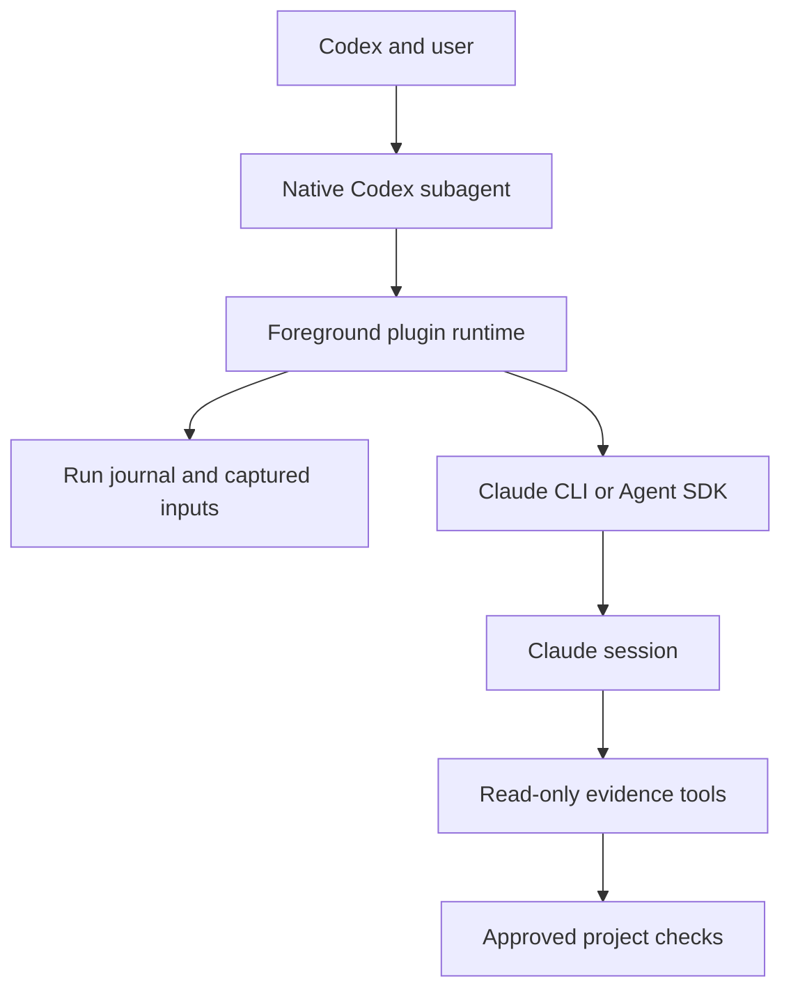

# Architecture

The Codex skills provide the user interface. Each Claude call runs in the foreground through a native Codex subagent; Codex retrieves Claude's saved answer and makes its own assessment. The TypeScript source builds a Node.js 24 runtime that ships with the skills.

| Module | Responsibility |
|---|---|
| `contracts.ts` | Settings, provider results, activity and errors |
| `workflows/` | Decision, review, custom-agent and resume state |
| `providers/` | Claude invocation, tool policy and response validation |
| `runtime/` | Configuration, journal, process ownership and cleanup |
| `inputs/` | Git and document capture with hashes and coverage gaps |
| `policy/` | Evidence tools and approved project checks |
| `presentation/` | Saved answers and activity transport |
| `plugin/claude/skills/` | Codex coordination and user interaction |

The runtime captures selected review inputs and records each run in a local journal. Custom-agent instructions are loaded from one project or personal Markdown file and frozen with the run. Claude can read and search, while editing, general shell commands and delegation are denied. Custom agents cannot run project checks. For the built-in workflows, a named check runs only after project approval. Checks execute real code in the checkout with the host user's permissions; process containment is not a filesystem sandbox.

The foreground driver owns its provider and check processes. Interrupted provider calls and checks with unknown outcomes preserve their evidence and are never replayed automatically. `$claude:runs` reads the saved answer and status without starting another call.

During `$claude:setup`, the launcher verifies the packaged bundle and installs locked dependencies into a versioned per-user runtime. Configuration and run history use a separate per-user data directory, so installing a new runtime does not migrate or delete saved runs.
