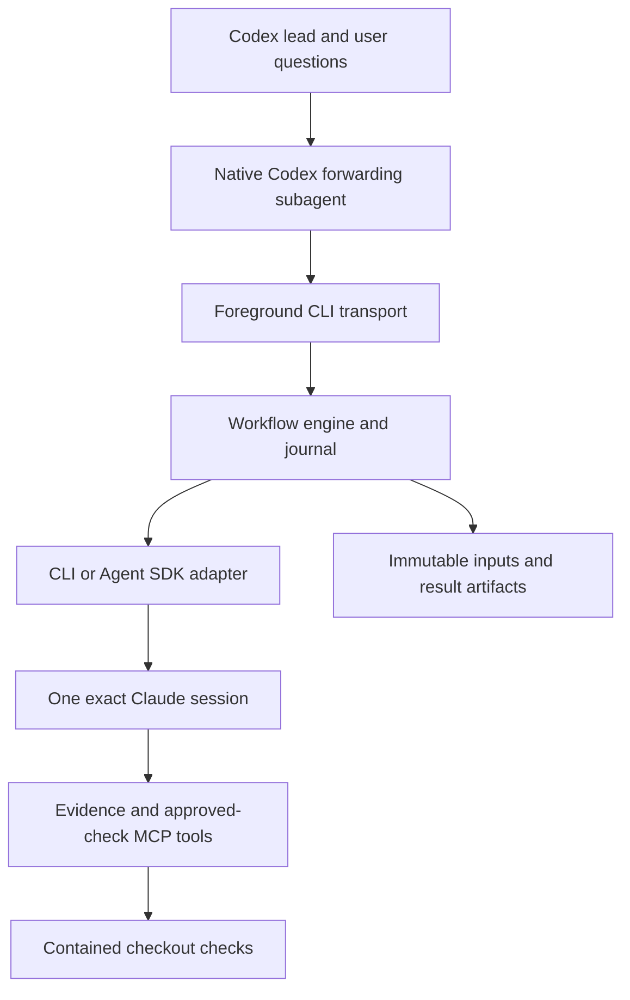

# Architecture

One Node 24 package, strict TypeScript, ESM, Zod contracts and locked dependencies. The compiled runtime and Codex skills ship together.

| Module | Responsibility |
|---|---|
| `contracts.ts` | Typed provider output, settings, activity and errors |
| `workflows/` | Requests, immutable proposals, assessments, checkpoints and resume transitions |
| `providers/` | Explicit authentication, invocation policy, stream normalization and terminal validation |
| `runtime/` | Files, journal, configuration, process identity, ownership and cleanup |
| `inputs/` | Git/document capture, hashes, omissions and checkout fingerprints |
| `policy/` | Evidence MCP and named check approvals/receipts |
| `presentation/` | Markdown answer display, exact segments and activity transport |
| `cli.ts` | Strict machine transport and internal assessment/checkpoint operations |
| `plugin/claude/skills/` | Native relay, independent reasoning, user interaction and rendering |

The engine reserves a request under a short filesystem mutex, releases it, calls the provider, then commits the terminal result in another transaction. Activity batches commit independently. Checks first claim a durable `outcome_unknown` receipt under their own short mutex; checks never execute under a lock. Subsequent identical requests cannot automatically replay an unresolved attempt. Ticket locks use atomic publication, process start identities and ordered local-filesystem contenders. Dead tickets are ignored without deleting another writer's lock. The journal remains authoritative; reads do not recover, migrate or mutate anything. A write repairs only a torn final record; interior corruption fails.

Each counsel request owns the saved brief and the hash of the current proposal. A model-echoed identifier never selects a request. A completed terminal schema result leads to `awaiting_lead`; Codex's independent assessment leads to agreement, another allowed round, or a persisted user checkpoint. Terminal failures preserve their specific codes and evidence. Unknown outcomes never imply completion.

The provider worker, evidence server and check processes belong to the foreground driver. Windows starts the worker suspended, assigns it to a kill-on-close Job Object, records it, verifies the driver identity, then resumes it. POSIX registers a waiting group leader before releasing its start gate; the watchdog kills the group on driver loss, cancellation or normal completion. No name-based or global process killing is used. Watchdogs exist only while the execution they own exists.

Claude receives explicit Read/Glob/Grep/web tools, the plugin's evidence MCP tools, deterministic denials for general shell/edit/delegation tools, restricted settings sources, disabled hooks and strict MCP configuration. Managed restrictions are retained. The Agent SDK uses the same CLI engine controls through official options and an owned spawn hook. Effective effort is tracked separately from requested effort. Response model identity comes from assistant/stream messages and must match; init metadata alone is insufficient.

Snapshot artifacts identify what was reviewed. Real-checkout checks identify what was executed. Changes during capture become a coverage gap. Changes during or before a check are reported as fingerprint differences. Selected index and worktree states are distinct. Evidence content may contain instructions; it is never an authorization source.

The launcher verifies the compiled bundle, installs a content-addressed version with locked npm dependencies, and checks its source-file hashes before import. Per-user state is independent of runtime version. Runtime directories are immutable by contract; a changed file fails verification. The runtime performs no automatic migration, commit, deployment or publication.

The foreground companion's internal `--receipt-only` mode returns status, exact IDs, hashes and artifact references to the forwarding subagent. Main then reads the complete committed result through `runs`; it verifies the artifact against the journal and returns full rawOutput, verdict and Markdown answer. Large raw JSON and answers can be retrieved in ordered segments. This avoids model-retyped JSON and redundant copies in the native agent handoff, while keeping the full counsel output in the main context before assessment.
